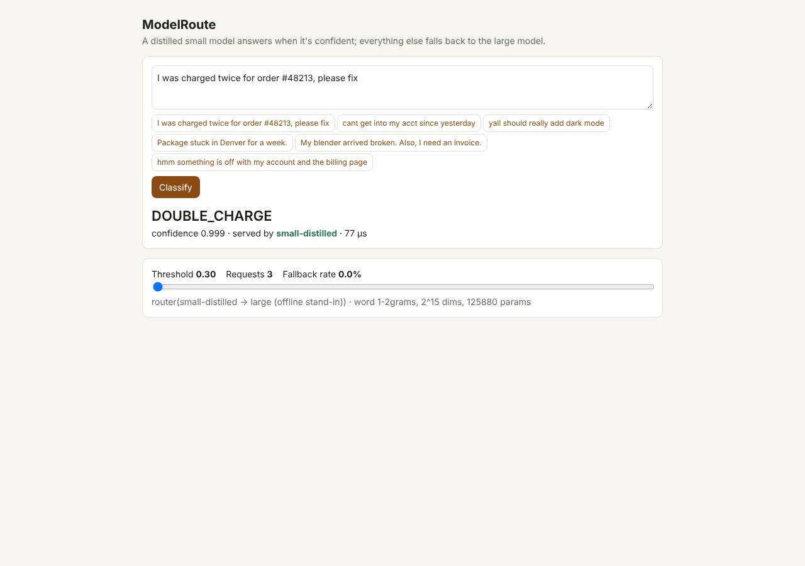
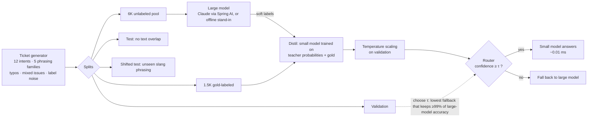

# ModelRoute

**Replace expensive large-model calls for a repetitive task with a small specialized model, and route only the uncertain requests back to the large one, with the accuracy, latency and cost of every option measured.**

The task is customer-support ticket intent classification across 12 intents. The stack is Java 21, Spring Boot 3.5 and Spring AI 1.1 for the data, distillation, router, serving API and evals, plus Python (PEFT) for the LoRA/QLoRA fine-tune of an open-weight model.



---

## Pipeline



| Step | Where |
|---|---|
| Labeled dataset of thousands of realistic tickets, with an **evaluation set fully separated from training** (no shared text) **plus a distribution-shift set** written in phrasing never seen in training | `data/TicketGenerator`, `templates.json`, `DatasetExporter` (JSONL for Python) |
| Baseline with a larger model | `LlmClassifier` (Claude, structured output) or the offline stand-in (char+word n-gram model with a kNN memory) |
| Distillation: the large model labels a pool and the small model learns its **soft** probabilities | `model/Pipeline` |
| LoRA / QLoRA fine-tune of an open-weight model | `finetune/train_lora.py` (sequence-classification head, 4-bit option) |
| Serving the fine-tuned model behind an API | `finetune/serve.py` (LoRA merged at load), consumed by `HttpClassifier` |
| Confidence router with calibrated threshold | `router/ConfidenceRouter`, temperature scaling in `LinearClassifier.calibrate` |
| Accuracy and F1, p50/p95 latency, cost per 1K requests, fallback rate, quality vs. baseline | `eval/EvalRunner` |
| Production API | `POST /api/classify`, `GET /api/stats`, `POST /api/threshold` |

## Results (offline run)

<!-- RESULTS:START -->
1500 gold-labeled + 6000 large-model-labeled training tickets · 1000 validation · 2000 test tickets (no text overlap with training) · 12 intents

| System | Accuracy | Macro-F1 | Quality vs large | Fallback rate | p50 latency | p95 latency | Cost / 1K requests |
|---|---|---|---|---|---|---|---|
| Large model only | 91.9% | 0.914 | 100.0% | 100.0% | 711.04 ms | 1445.45 ms | $0.8912 |
| Small, gold labels only | 91.6% | 0.911 | 99.7% | 0.0% | 0.04 ms | 0.07 ms | $0.0000 |
| Small, distilled | 92.0% | 0.914 | 100.1% | 0.0% | 0.01 ms | 0.03 ms | $0.0000 |
| Router (distilled small -> large) | 91.9% | 0.914 | 100.0% | 0.1% | 0.01 ms | 0.03 ms | $0.0009 |

**Router vs. large model only:** cost per 1K requests $0.8912 → $0.0009, p95 latency 1445 ms → 0.03 ms, quality retained 100.0%.

Routing threshold 0.300 on calibrated confidence (temperature 0.70), chosen on validation to keep ≥ 99% of the large model's accuracy (validation: router 92.0% vs large 91.9%, fallback 0.0%).

Small model: word 1-2grams, 2^15 dims, 125,880 non-zero parameters. Large model: large (offline stand-in) (measured compute p50 4.32 ms; latency above uses a simulated hosted-API profile, median 700 ms).

**Distribution shift** (1000 tickets in casual phrasing never seen in training):

| System | Accuracy | Macro-F1 | Fallback rate |
|---|---|---|---|
| Large model only | 59.7% | 0.588 | 100.0% |
| Small, gold labels only | 50.9% | 0.493 | 0.0% |
| Small, distilled | 50.9% | 0.484 | 0.0% |
| Router (distilled small -> large) | 54.0% | 0.520 | 14.7% |

Threshold sweep (what an operator tunes): fallback rate / accuracy / cost per 1K

| Threshold | In-distribution | Shifted |
|---|---|---|
| 0.30 | 0% / 91.9% / $0.001 | 15% / 54.0% / $0.132 |
| 0.50 | 1% / 91.9% / $0.008 | 46% / 58.1% / $0.411 |
| 0.60 | 3% / 91.9% / $0.032 | 64% / 58.7% / $0.567 |
| 0.70 | 6% / 91.9% / $0.057 | 77% / 58.6% / $0.684 |
| 0.80 | 10% / 92.0% / $0.089 | 85% / 58.7% / $0.760 |
| 0.90 | 15% / 91.9% / $0.137 | 91% / 59.2% / $0.814 |
| 0.95 | 21% / 91.9% / $0.195 | 95% / 59.5% / $0.849 |
| 0.99 | 42% / 91.9% / $0.380 | 99% / 59.7% / $0.882 |

Per-intent F1, distilled small model:

| Intent | F1 |
|---|---|
| BILLING_REFUND | 0.937 |
| DOUBLE_CHARGE | 0.876 |
| LOGIN_ISSUE | 0.907 |
| PASSWORD_RESET | 0.916 |
| SHIPPING_DELAY | 0.953 |
| ADDRESS_CHANGE | 0.899 |
| DAMAGED_ITEM | 0.924 |
| CANCEL_SUBSCRIPTION | 0.907 |
| UPGRADE_PLAN | 0.940 |
| BUG_REPORT | 0.910 |
| FEATURE_REQUEST | 0.915 |
| INVOICE_REQUEST | 0.890 |

_Regenerate with the eval command below. Raw output: [`eval/results/`](eval/results/)._
<!-- RESULTS:END -->

**What this run shows, and what it doesn't**

- **On in-distribution traffic a 126K-parameter distilled model matches the large model.** At the threshold chosen on validation, the router almost never falls back, so cost per 1K requests drops from about $0.89 to under $0.01 at the same accuracy. The ~8% error ceiling on both comes from tickets that mention two issues: the label is the first issue raised, which a bag-of-n-grams model can't always tell apart.
- **Under distribution shift, routing earns its keep.** On unseen slang phrasing the small model drops to about 51%. The fallback rate climbs automatically from about 0% to 15%, which makes it a free drift alarm. Raising τ to 0.5 recovers most of the large model's accuracy (58.1% vs 59.7%) at less than half its cost.
- **The offline large model is a stand-in, not a frontier model.** It's an n-gram/kNN ensemble, which is why it also degrades under shift. With `LLM_PROVIDER=anthropic` the same harness uses Claude as the large model, and that's the run to report externally. A frontier model should hold up far better on the shifted set, which makes routing matter more.
- **Latency for the large model uses a simulated hosted-API profile** (lognormal, median 700 ms). Costs use configurable assumptions (`CostModel`): $3/$15 per million input/output tokens for the large model, and a $0.10/h instance for the small one.

## Quick start

```bash
mvn spring-boot:run                     # trains the pipeline at startup (~15 s), then http://localhost:8080
curl -s localhost:8080/api/classify -H 'Content-Type: application/json' -d '{"text":"I was charged twice for order #48213"}'
# {"intent":"DOUBLE_CHARGE","confidence":0.999,"servedBy":"small-distilled","fellBack":false,...}
curl -s localhost:8080/api/stats
curl -s localhost:8080/api/threshold -H 'Content-Type: application/json' -d '{"value":0.8}'

mvn -q compile exec:java                # full eval -> eval/results/
```

### Run it with real models

```bash
# 1. Export the dataset
mvn -q compile exec:java -Dexec.mainClass=com.saipramod.modelroute.data.DatasetExporter -Dexec.args="data 7500"

# 2. Fine-tune a small open-weight model with LoRA (GPU), or QLoRA with --qlora
pip install -r finetune/requirements.txt
python finetune/train_lora.py --data data --model Qwen/Qwen2.5-0.5B --out models/intent-lora

# 3. Serve it
python finetune/serve.py --model models/intent-lora --port 8001

# 4. Route between the fine-tuned model and Claude
SMALL_MODEL_URL=http://localhost:8001 LLM_PROVIDER=anthropic ANTHROPIC_API_KEY=sk-ant-... mvn spring-boot:run
```

`train_lora.py` writes `eval.json` with accuracy and macro-F1 on the in-distribution and shifted test sets, so you can put the fine-tuned model in the same table.

## Project layout

```
data/      TicketGenerator (+ resources/data/templates.json), DatasetExporter
model/     FeatureHasher, SoftmaxRegression (soft-label SGD), LinearClassifier (+ temperature scaling),
           KnnClassifier, EnsembleClassifier, LlmClassifier, HttpClassifier, Pipeline
router/    ConfidenceRouter (threshold selection on validation), CostModel
eval/      EvalRunner (systems table, shifted-set table, threshold sweep, per-intent F1)
finetune/  train_lora.py, serve.py, requirements.txt
```

## Limitations and next steps

- **The tickets are synthetic.** Replace them with a real labeled export, kept time-split so the test set comes after training.
- **The Claude + LoRA run hasn't been executed here.** That needs an API key and a GPU. The harness is ready for both.
- **Drift detection is passive.** Alert when the live fallback rate leaves its validation band, and periodically re-label fallback traffic with the large model to retrain the small one, closing the distillation loop.

## Resume bullet

> Built ModelRoute, a Java/Spring AI distillation and routing platform for support-ticket classification. A large model labels data, a compact student is distilled from its soft labels (LoRA/QLoRA path for open-weight models included), and a calibrated confidence router falls back to the large model only when needed. In the offline evaluation it kept **100% of baseline accuracy while cutting estimated cost per 1K requests from $0.89 to under $0.01**, and its fallback rate rose from ~0% to 15% on out-of-distribution tickets, acting as an automatic drift signal.
